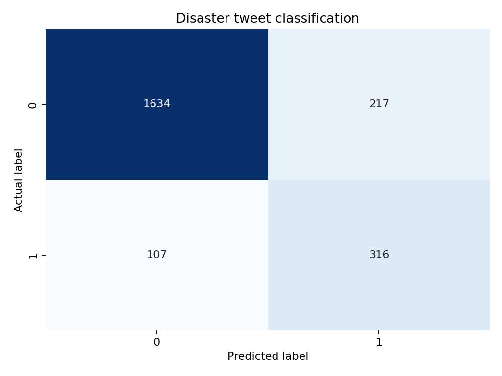

# Disaster Tweets Text Mining

An interpretable text-mining project based on Kaggle's **Natural Language Processing with Disaster Tweets** challenge. The goal is to identify tweets that describe real disasters.

## Why this project matters

Emergency teams may need to review a very large volume of social-media posts. A simple, explainable classifier can help prioritise messages for human review.

## Approach

1. Check class balance and missing values.
2. Explore common words in disaster and non-disaster tweets.
3. Convert text into TF-IDF features using unigrams and bigrams.
4. Compare a majority-class baseline with logistic regression.
5. Evaluate accuracy, precision, recall, F1 score and the confusion matrix.
6. Inspect the words that most strongly influence each prediction class.

## Results

The balanced logistic-regression model achieved **0.858 accuracy, 0.747 recall and 0.661 F1** on the holdout set. This was materially better than the majority baseline, whose F1 score was 0 because it missed every disaster tweet. Run `python disaster_tweets_text_mining.py` to reproduce the results.



## Repository structure

```text
disaster_tweets.csv        Dataset used for analysis
disaster_tweets_text_mining.py       End-to-end reproducible analysis
disaster_tweets_text_mining.ipynb    Executed Jupyter notebook for step-by-step review
requirements.txt           Python dependencies
outputs/                   Saved metrics and charts
```

## How to run

```bash
python -m venv .venv
source .venv/bin/activate
pip install -r requirements.txt
python disaster_tweets_text_mining.py
```

To review interactively, open `disaster_tweets_text_mining.ipynb` in Jupyter and run all cells from the project folder.

## Data source

Kaggle challenge: [Natural Language Processing with Disaster Tweets](https://www.kaggle.com/competitions/nlp-getting-started)

The dataset contains tweet text, an optional keyword and location, and a binary target. The target is 1 for a real disaster and 0 otherwise.

## Skills demonstrated

Python, pandas, text cleaning, TF-IDF, logistic regression, classification metrics, data visualisation and interpretation.
